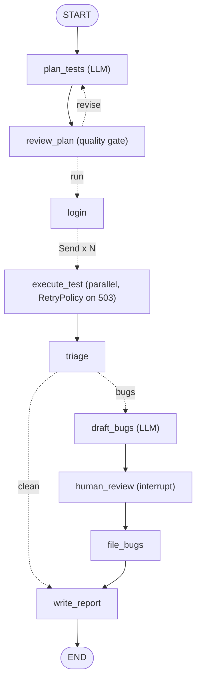

# Capstone: an Autonomous API QA Agent

| | |
|---|---|
| **Time** | 90 minutes (reading, running, then the challenges) |
| **LLM needed** | Optional (runs offline without a key) |
| **Code** | [`capstone_api_qa_agent.py`](capstone_api_qa_agent.py) · tests in [`../tests/test_capstone_and_api.py`](../tests/test_capstone_and_api.py) |
| **Uses** | Every lesson: 1, 2, 3, 4, 6, 7, 8 and 10 directly, and the agent ideas from 5 and 9 |

## What it does

Give it an API spec and a base URL. It:

1. **plans** API tests from the spec (Claude, structured output), Lesson 4
2. **checks the plan** with a deterministic gate and asks for a revision if needed, Lessons 3 and 4
3. **logs in once**, like a session fixture, then **runs every test in parallel**, Lesson 8
4. **retries 503s automatically**, because a flaky environment isn't a bug, Lesson 3
5. **triages** each failure into `product_bug` or `needs_review`, Lesson 2
6. **drafts bug reports** (Claude), then **pauses for a human** to pick which to file, Lesson 7
7. **files** the approved bugs and **writes a Markdown report**, Lesson 1
8. does it all **checkpointed**, so the pause can last as long as needed, Lesson 6

## The graph



## Run it

```bash
python lessons/capstone_api_qa_agent.py            # you choose which bugs to file
python lessons/capstone_api_qa_agent.py --auto     # file everything
```

```text
   T05 got 503 Service Unavailable - RetryPolicy will re-run it
   T03 got 503 Service Unavailable - RetryPolicy will re-run it

--- PAUSED for human review: 4 bug draft(s) ---
  1. [major] GET /booking/abc returns 500 instead of 404 (get non-numeric id)
  2. [major] POST /booking returns 500 instead of 400 (create without firstname)
  3. [minor] POST /booking returns 200 instead of 400 (create with negative price)
  4. [minor] POST /booking returns 200 instead of 400 (create with checkout before checkin)
file which bugs? e.g. 1,3 | all | none > all

# API QA Report - Booking API
**9/13 tests passed**
| Test | Request | Expected | Actual | Result |
...
## Bugs filed
- QA-101: GET /booking/abc returns 500 instead of 404 (get non-numeric id) (major)
...
Report saved to reports/capstone_report.md
```

The API starts with `flaky_503=2`, so the first two `GET /booking/{id}` calls fail with 503.
`RetryPolicy` re-runs those tests, and they pass: **flakiness is absorbed, not reported as a bug.**

## Design decisions worth studying

| Decision | Why |
|---|---|
| Only 2 of 9 nodes call an LLM | everything else is deterministic, fast, free and testable |
| `review_plan` is plain Python | never trust an LLM plan blindly, **check it** (Lesson 4) |
| The prompt says "tests run in parallel, only booking 3 may be changed" | parallel tests must be independent (Lesson 8) |
| `ServiceUnavailable` plus `RetryPolicy` | retry infrastructure errors, never assertion failures (Lesson 3) |
| `needs_review` category | not every mismatch is a bug: spec gaps go to a human |
| `interrupt()` before filing | an agent must never spam Jira by itself (Lesson 7) |
| Checkpointer plus `thread_id` | the human review can happen hours later; a crashed run can resume (Lesson 6) |
| `recursion_limit` 60 | a hard budget for the whole run |

## Point it at the real restful-booker (optional)

The local API mirrors the public practice API at `https://restful-booker.herokuapp.com`. Its behaviour
differs in places (for example, it returns 405 for deleting an unknown id), so expect some
`needs_review` findings. That's a great exercise in reading a spec critically.

```python
from capstone_api_qa_agent import run
final = run("https://restful-booker.herokuapp.com", auto=True)
```

## Challenges

1. **Duplicate detection.** Before `human_review`, skip drafts whose title already exists in `JIRA`
   (run the capstone twice in one process to test it).
2. **Severity policy.** Add a node that upgrades any 5xx to `critical` when the endpoint is `POST`
   or `PUT` (data-changing), and write a test for it.
3. **Real Jira.** Replace `file_bugs` with a call to your Jira (REST API or MCP). Keep the interrupt!
4. **Resume after a crash.** Make `execute_test` raise on the 3rd consecutive 503. Start the API with
   `flaky_503=10`, watch the run fail, then resume it with `graph.invoke(None, config)` after
   the environment "recovers".
5. **Multi-agent version.** Rebuild the capstone as Lesson 9's team: a lead plus planner, executor
   and reporter. Which version is easier to test? Which is more flexible?
6. **Your own API.** Swap `API_SPEC`, `base_url` and `login` for an API you test at work.

## You made it

You can now build, run, test and reason about LangGraph applications for QA:

- graphs, state, reducers, routing, loops and guards
- LLM steps with structured output and deterministic quality gates
- tool-using agents, multi-agent teams, parallel fan-out
- checkpoints, resume, time travel, and human approval
- and, above all, **how to test AI systems**, which is the skill that makes a QA engineer invaluable
  on an AI team.

---
Previous: [Lesson 10](l10_testing_your_agents.md) · Back to the [course home](../README.md)
