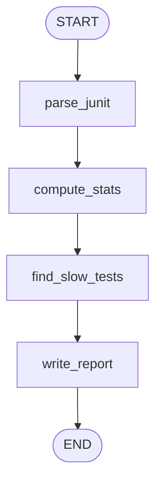

# Lesson 1: Your first graph (a Test Report Summarizer)

| | |
|---|---|
| **Time** | 30 minutes |
| **LLM needed** | No |
| **Code** | [`l01_first_graph.py`](l01_first_graph.py) |
| **You will learn** | State, nodes, edges, `compile()`, `invoke()`, `stream()` |

## Why a QA engineer should care

A real QA workflow is almost never a straight line:

- a test fails, so you **branch**: is it a product bug, a flaky test, or a broken environment?
- a flaky test gets **retried**, which is a loop
- a bug report waits for the QA lead's **approval**, so the workflow pauses for a human
- a 2-hour regression run **crashes at minute 90**, and you want to resume, not restart

A single "prompt, then LLM, then answer" call can't express any of that. **LangGraph lets you draw your
workflow as a flowchart where every box is a plain Python function.** Some boxes call an LLM, most
don't. LangGraph handles the branching, looping, pausing and resuming for you.

| | Plain LLM call | LangChain chain | **LangGraph** |
|---|---|---|---|
| Shape | one step | straight line A to B to C | any flowchart: branches, loops, parallel |
| State | none | passed along implicitly | explicit, typed, visible at every step |
| Pause for human approval | build it yourself | build it yourself | built in (`interrupt()`, Lesson 7) |
| Resume after a crash | no | no | built in (checkpoints, Lesson 6) |

In this lesson there's **no AI at all**. That's deliberate: you learn the mechanics before adding an LLM.

## The 4 building blocks

| Block | What it is | QA analogy |
|---|---|---|
| **State** | A `TypedDict` that flows through the graph | The test context every step can read, like a shared fixture |
| **Node** | A Python function `state -> dict of changes` | One step of your pipeline |
| **Edge** | An arrow: "after this node, run that one" | The execution order |
| **Compile** | Turns the blueprint into a runnable app | Like building your test suite before running it |

## The graph you are building



Input: a JUnit XML report, the format pytest, Maven Surefire and Jenkins all produce.
Output: a release summary with a GO / NO-GO verdict.

## Run it

```bash
python lessons/l01_first_graph.py
```

Output (trimmed):

```text
=== Watch the state flow, one node at a time ===
[parse_junit] returned keys: ['results']
[compute_stats] returned keys: ['stats']
[find_slow_tests] returned keys: ['slow_tests']
[write_report] returned keys: ['report']

=== The normal way to run a graph: invoke() -> final state ===
# Test Run Summary
Release verdict: NO-GO
Total 10 | Passed 6 | Failed 3 | Skipped 1 | Pass rate 66.7%

## Failures
- tests.test_login.test_locked_account: AssertionError: expected 'Account locked' but got 'Invalid password'
- tests.test_checkout.test_checkout_with_card: AssertionError: expected 'Order confirmed' but got 'Payment declined'
- tests.test_checkout.test_checkout_with_upi: TimeoutException: payment gateway did not respond in 15s
...
```

Try it on your own project too:

```bash
pytest --junitxml=junit.xml          # in any pytest project
python lessons/l01_first_graph.py junit.xml
```

## Code walkthrough

**1. State** declares every key the graph can hold:

```python
class ReportState(TypedDict):
    junit_xml: str         # input
    results: list[dict]
    stats: dict
    slow_tests: list[str]
    report: str            # output
```

**2. A node** reads the state and returns **only the keys it changed**:

```python
def find_slow_tests(state: ReportState) -> dict:
    slow = [r for r in state["results"] if r["time"] > SLOW_SECONDS]
    ...
    return {"slow_tests": [...]}   # LangGraph merges this into the state
```

**3 and 4. Wire it up and compile:**

```python
builder = StateGraph(ReportState)
builder.add_node("parse_junit", parse_junit)
...
builder.add_edge(START, "parse_junit")
builder.add_edge("parse_junit", "compute_stats")
...
graph = builder.compile()

final_state = graph.invoke({"junit_xml": xml_text})   # pass only the inputs
```

## Rules to remember

1. A node gets the **whole** state and returns a dict with **only the keys it changed**.
2. By default a returned value **overwrites** that key. Lesson 2 shows how to *append* instead.
3. `invoke()` only needs the input keys. The rest get filled in as nodes run.
4. `stream(..., stream_mode="updates")` shows what each node returned. **It is your #1 debugging tool.**
5. Build and compile once, then `invoke()` as many times as you like.

## Exercises

1. **Add a verdict node.** Add a `release_verdict` node between `find_slow_tests` and `write_report`.
   It returns `NO-GO` if the pass rate is under 90% **or** any `tests.test_checkout` test failed,
   and `GO` otherwise. Store it in a new state key `verdict` and use it in the report.
2. **Your own report.** Run the graph on a real `junit.xml` from one of your projects.
3. **Shortcut.** Replace the four `add_node` calls and five `add_edge` calls with
   `builder.add_sequence([parse_junit, compute_stats, find_slow_tests, write_report])` plus
   `builder.add_edge(START, "parse_junit")`. Nodes get their function names. Is the output identical?
4. **Break it on purpose.** Make `compute_stats` return `{"stat": ...}` (a typo). Where does it fail?
   *(Answer: LangGraph silently ignores keys that aren't in your State. You get a `KeyError: 'stats'`
   later, in `write_report`, not where you made the typo. State keys are a contract between nodes.)*

## Interview questions

<details>
<summary>What is a <code>StateGraph</code>?</summary>

A graph whose nodes communicate through a shared, typed state object. You declare the state schema,
add nodes (functions) and edges (execution order), then `compile()` it into a runnable app.
</details>

<details>
<summary>Why do nodes return partial updates instead of the whole state?</summary>

Each node only declares what it changed, so nodes stay small and independent, parallel nodes
can't clobber each other's keys, and LangGraph can apply reducers (for example "append to list")
when it merges the updates.
</details>

<details>
<summary>How is LangGraph different from a LangChain chain?</summary>

A chain is a straight pipeline. LangGraph supports cycles, conditional branches, parallel
fan-out, explicit state, checkpoints (resume and time travel) and human-in-the-loop pauses. Those
are exactly what agents and real QA workflows need.
</details>

---
Next: [Lesson 2: Conditional edges (a Failure Triage Router)](l02_conditional_routing.md)
