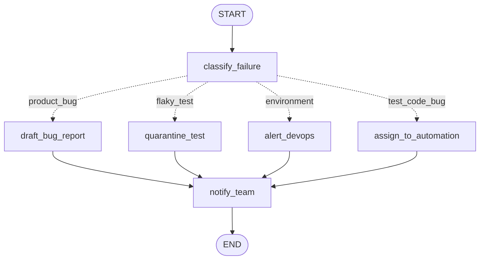

# Lesson 2: Conditional edges (a Failure Triage Router)

| | |
|---|---|
| **Time** | 30 minutes |
| **LLM needed** | No |
| **Code** | [`l02_conditional_routing.py`](l02_conditional_routing.py) |
| **You will learn** | `add_conditional_edges`, router functions, reducers, `batch()` |

## The QA problem

Your nightly run has 40 failures. They don't all go to the same person:

| Category | Signal | Next step |
|---|---|---|
| **product_bug** | consistent assertion failure | draft a bug for the dev team |
| **flaky_test** | the result keeps flipping pass/fail | quarantine and stabilise the test |
| **environment** | connection refused, 502/503, grid down | alert DevOps, don't blame the product |
| **test_code_bug** | `NoSuchElementException`, stale element | the automation engineer fixes the locator |

That "if category is X, go to box Y" logic is a **conditional edge**.

## The graph



Dotted arrows are conditional: exactly one of them is taken per run. All branches meet again at `notify_team`.

## Run it

```bash
python lessons/l02_conditional_routing.py
```

```text
test_search_suggestions  ->  FLAKY_TEST
   1. classified as flaky_test (result flipped 3 times in ['pass', 'fail', 'pass', 'pass', 'fail'])
   2. quarantined the test and opened a ticket to stabilise it
   3. posted triage result to #qa-triage: flaky_test

test_login_sso  ->  ENVIRONMENT
   1. classified as environment (the error points at infrastructure, not the app)
   2. alerted #devops; re-run after the environment is fixed
   3. posted triage result to #qa-triage: environment
...
```

## New concept 1: conditional edges

A **router** is a plain function. It reads the state and returns a **label**:

```python
def route_by_category(state) -> Literal["product_bug", "flaky_test", "environment", "test_code_bug"]:
    return state["category"]
```

The **path map** turns labels into node names:

```python
builder.add_conditional_edges(
    "classify_failure",        # after this node...
    route_by_category,         # ...call this router...
    {                          # ...and follow the matching arrow
        "product_bug": "draft_bug_report",
        "flaky_test": "quarantine_test",
        "environment": "alert_devops",
        "test_code_bug": "assign_to_automation",
    },
)
```

The router **decides**, it doesn't **do**. Keep the work in nodes and keep routers small, pure and
easy to unit-test. In Lesson 10 you'll test every route with one parametrized pytest.

> Design insight: the classifier here is a set of rules. In later lessons you can swap it for an
> LLM classifier and **the graph doesn't change at all**. That's the power of separating
> "who decides" from "what happens next".

## New concept 2: reducers (append instead of overwrite)

```python
actions: Annotated[list[str], operator.add]
```

Normally a node's return value **replaces** the key. With a reducer, LangGraph **combines** the old
and new values. Here, `operator.add` on lists means append, so after three nodes you have a
three-line audit trail.

Without the reducer you'd only see the last node's action. Try it: change the line to
`actions: list[str]` and run again.

## New concept 3: `batch()`

```python
results = graph.batch(FAILURES)   # one run per failure, executed concurrently
```

`invoke` runs one input, `batch` runs many, and `stream` shows the steps.

## A smart detail: flaky vs regression

```python
def count_flips(runs):   # pass->fail or fail->pass changes
    ...
```

- `pass, pass, pass, fail` has 1 flip: a **regression** (something broke), so it's a product bug
- `pass, fail, pass, pass, fail` has 3 flips: **flaky**

A naive rule like "it passed before, so it's flaky" would hide real regressions. This is the kind of
domain knowledge you, the QA engineer, bring to an AI workflow.

## Exercises

1. **New category.** Add `performance`: if the error contains `"exceeded SLA"`, route to a new
   `open_perf_ticket` node. Add a sample failure to `FAILURES` that triggers it.
2. **Skip notification for flaky tests.** Make `quarantine_test` go straight to `END`. Which
   `add_edge` do you change?
3. **Router returning END.** Make the router return `END` directly when `recent_runs` is empty
   (not enough data to triage). Hint: add `END: END` to the path map.
4. **Remove the reducer** (`actions: list[str]`) and explain the output.

## Interview questions

<details>
<summary>How do you implement branching in LangGraph?</summary>

With `add_conditional_edges(source, router, path_map)`. After `source` runs, the router function
receives the state and returns a label; the path map says which node that label leads to. A node
can also route itself by returning `Command(goto=...)` (Lesson 9).
</details>

<details>
<summary>What is a reducer and when do you need one?</summary>

A function that tells LangGraph how to merge a node's update into an existing key. The default
is overwrite. You need one for accumulating values (logs, results, messages) and whenever parallel
nodes write to the same key. Common reducers are `operator.add` for lists and `add_messages` for chat.
</details>

<details>
<summary>Why keep routing logic in a separate function?</summary>

It's a pure function of the state, so it's trivial to unit-test exhaustively. You can also swap the
decision maker (rules or an LLM) without touching the graph, and the graph diagram shows every
possible path.
</details>

---
Previous: [Lesson 1](l01_first_graph.md) · Next: [Lesson 3: Loops (a Flaky Test Retrier)](l03_loops_retry.md)
