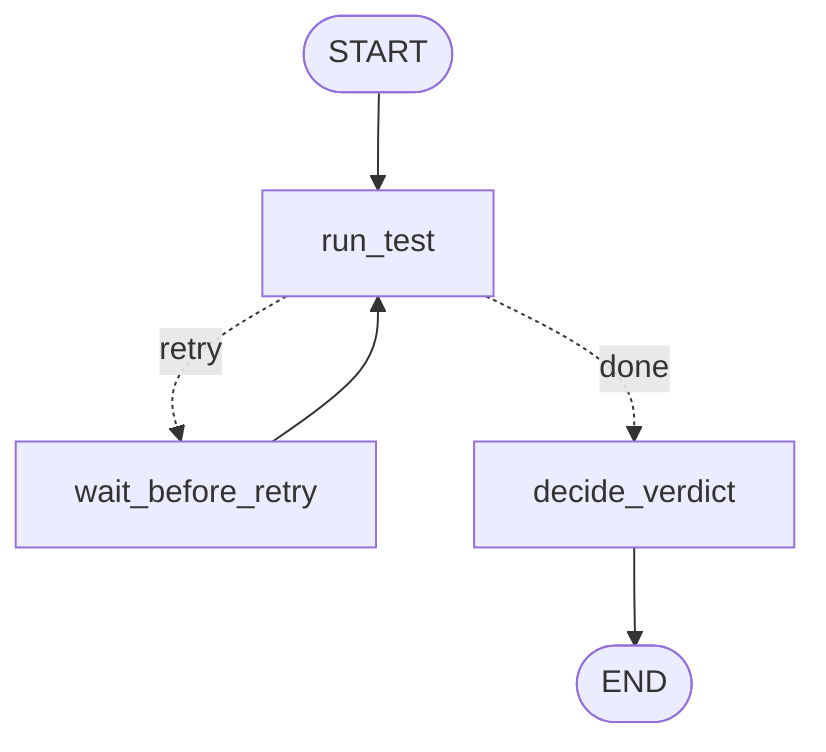

# Lesson 3: Loops (a Flaky Test Retrier, with guardrails)

| | |
|---|---|
| **Time** | 30 minutes |
| **LLM needed** | No |
| **Code** | [`l03_loops_retry.py`](l03_loops_retry.py) |
| **You will learn** | Cycles, loop guards, `recursion_limit`, `GraphRecursionError`, `RetryPolicy` |

## The QA problem

A test failed. Before anyone files a bug, re-run it:

| History | Verdict | Action |
|---|---|---|
| `pass` | **PASSED** | nothing |
| `fail, fail, pass` | **FLAKY** | quarantine, don't file a product bug |
| `fail, fail, fail` | **FAILED** | real failure, triage it (Lesson 2) |

"Run, check, maybe run again" is a **loop**, and loops are where LangGraph beats simple
pipelines. Chains can't go backwards; graphs can.

## The graph



The cycle is `run_test -> wait_before_retry -> run_test`. It's just an edge that points back.

## Run it

```bash
python lessons/l03_loops_retry.py
```

```text
=== 1. The retry loop ===
test_search_suggestions
   attempt 1: fail
   attempt 2: fail
   attempt 3: pass
   verdict: FLAKY

=== 2. Guardrail: a buggy router that forgot the attempt limit ===
Stopped by recursion_limit: Recursion limit of 10 reached without hitting a stop condition. ...

=== 3. RetryPolicy: automatic retries for exceptions ===
browser session ready (took 3 attempts)
```

## Concept 1: a loop = conditional edge + back edge

```python
builder.add_conditional_edges("run_test", should_retry,
                              {"retry": "wait_before_retry", "done": "decide_verdict"})
builder.add_edge("wait_before_retry", "run_test")   # <- the cycle
```

The router is the **loop condition**. The state carries what the condition needs (`attempts`, `history`).

## Concept 2: every loop needs TWO guards

**Guard 1, your own condition** (the real exit):

```python
def should_retry(state):
    if state["history"][-1] == "fail" and state["attempts"] < MAX_ATTEMPTS:
        return "retry"
    return "done"
```

**Guard 2, `recursion_limit`** (the safety net for bugs in guard 1):

```python
graph.invoke(inputs, {"recursion_limit": 10})   # the default is much higher
```

Every node execution counts as a step. When the limit is hit, LangGraph raises `GraphRecursionError`
instead of looping forever. Part 2 of the lesson shows a buggy router caught by this net.

> Why this matters even more with LLMs: in Lesson 5 the loop is "LLM calls a tool, reads the
> result, calls another tool...". A loop without a guard there doesn't just hang, **it burns
> money**. Always set a `recursion_limit` on agent runs.

## Concept 3: `RetryPolicy`, LangGraph's built-in retry

```python
builder.add_node(
    "open_browser_session", open_browser_session,
    retry_policy=RetryPolicy(max_attempts=5, initial_interval=0.1, retry_on=ConnectionError),
)
```

If the node **raises** `ConnectionError`, LangGraph re-runs it with exponential backoff and jitter.

### Which one should I use?

| Use an explicit loop when... | Use `RetryPolicy` when... |
|---|---|
| each attempt's result is **data** you want to keep and reason about (flaky detection needs the history) | the failure is a transient **exception** you just want to get past (grid waking up, 503, network blip) |
| you want the retry visible in the graph diagram | you want the graph to stay simple |

> **QA warning:** never put `retry_on=AssertionError` on a node that runs tests. Automatic
> retries on assertions **hide real bugs**. Retry infrastructure errors; *record* test failures.

## Exercises

1. **Configurable attempts.** Move `MAX_ATTEMPTS` into the state (`max_attempts: int`) so each
   test can have its own limit. Pass it in `invoke()`.
2. **Smarter verdict.** Add a new verdict `FLAKY-HIGH-RISK` when a test needed all attempts to pass.
3. **Count the steps.** With `recursion_limit=10`, how many attempts did the buggy loop make before
   it stopped? Use `stream(stream_mode="updates")` to verify your answer.
4. **Retry only what's transient.** Change `retry_on` to a function
   `lambda e: isinstance(e, ConnectionError) and "refused" in str(e)`.

## Interview questions

<details>
<summary>How do you create a loop in LangGraph, and how do you stop it?</summary>

A loop is a conditional edge whose router can send execution back to an earlier node. You stop it
with your own exit condition (counter or state check in the router), and LangGraph's
`recursion_limit` is the safety net that raises `GraphRecursionError` if your condition has a bug.
</details>

<details>
<summary>What's the difference between a retry loop and <code>RetryPolicy</code>?</summary>

A retry loop is part of your graph's logic: every attempt is recorded in the state and visible.
`RetryPolicy` is configuration on a node: LangGraph silently re-runs the node when it raises
matching exceptions, with backoff. Use loops for decisions, policies for transient errors.
</details>

<details>
<summary>What is a super-step?</summary>

One "tick" of the graph: all nodes that are scheduled together run (possibly in parallel), their
updates are applied to the state, then the next set of nodes is scheduled. `recursion_limit`
counts these steps.
</details>

---
Previous: [Lesson 2](l02_conditional_routing.md) · Next: [Lesson 4: Adding Claude (a Test Case Generator)](l04_llm_testcase_generator.md)
