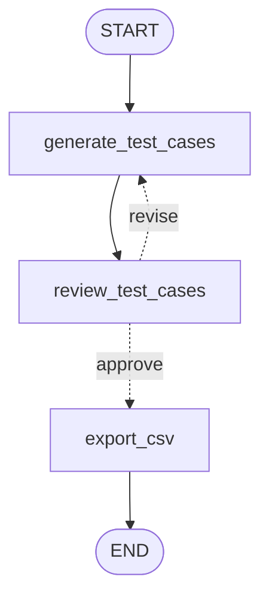

# Lesson 4: Adding Claude (a Test Case Generator with a quality gate)

| | |
|---|---|
| **Time** | 45 minutes |
| **LLM needed** | Optional (runs offline without a key) |
| **Code** | [`l04_llm_testcase_generator.py`](l04_llm_testcase_generator.py) · helper [`qa_llm.py`](qa_llm.py) |
| **You will learn** | LLM calls inside nodes, structured output, the generator/reviewer loop, guardrails |

## The QA problem

Writing test cases from user stories is slow. An LLM is fast, but its first draft typically:

- skips an acceptance criterion or two
- forgets the negative, boundary and security cases
- writes vague expected results like "it should work"

So we don't *trust* the LLM, we **check** it. The LLM writes; a plain-Python reviewer checks;
the draft loops back with feedback until it passes, with a maximum number of drafts.

## The graph



Only one box calls an LLM. **Most boxes in a good AI workflow are plain code.**

## Run it

```bash
python lessons/l04_llm_testcase_generator.py                       # offline, no key
export ANTHROPIC_API_KEY=sk-ant-...                                # then real Claude
python lessons/l04_llm_testcase_generator.py
QA_MODEL=claude-sonnet-5-5 python lessons/l04_llm_testcase_generator.py   # pick another model
```

```text
[draft 1] 4 test cases generated
[review] 5 issue(s):
   - Only 4 test cases; write at least 6.
   - AC3 is not covered by any test case.
   - AC5 is not covered by any test case.
   - No 'edge' test case.
   - No 'security' test case.

[draft 2] 9 test cases generated
[review] APPROVED

Final test suite:
  TC-01 [positive] P1 AC1     Request a reset link for a registered email
  ...
  TC-09 [security] P2 AC2     Response time does not reveal registered emails

CSV for TestRail / Xray / Zephyr written to reports/l04_test_cases.csv
```

> Offline mode replays a scripted "weak draft, then good draft" so you can watch the loop work.
> With a real key, Claude writes the cases, and your output will differ run to run. That's
> exactly why the quality gate exists.

## Concept 1: an LLM call is just another node

```python
def generate_test_cases(state):
    messages = [SystemMessage(SYSTEM_PROMPT), HumanMessage(state["user_story"])]
    suite = designer.invoke(messages)          # <- the LLM call
    return {"suite": suite, "drafts": state.get("drafts", 0) + 1}
```

Same contract as Lesson 1: read the state, return what changed.

## Concept 2: structured output (stop parsing text!)

```python
class TestCase(BaseModel):
    id: str = Field(description="Short id such as TC-01")
    type: Literal["positive", "negative", "edge", "security"]
    covers: list[str] = Field(description="Acceptance criteria ids this case verifies")
    steps: list[str]
    expected_result: str
    ...

designer = llm.with_structured_output(TestSuite, method="json_schema")
suite = designer.invoke(messages)     # a TestSuite object, already validated
```

- `method="json_schema"` uses Claude's **native structured output**: the reply is constrained to
  your schema, so there's no regex parsing and no "the LLM forgot a field".
- `Literal[...]` becomes an enum, so the LLM **cannot** invent a new test type.
- `Field(description=...)` is sent to the model. **Descriptions are prompts.**

## Concept 3: the generator/reviewer loop

```python
def route_after_review(state):
    if state["review_issues"] and state["drafts"] < MAX_DRAFTS:
        return "revise"      # back to the LLM, with the issues as feedback
    return "approve"
```

This is Lesson 3's loop again. The feedback goes into the next prompt, together with the previous
draft, so the model *fixes* instead of starting over. `MAX_DRAFTS` is the loop guard, which also
caps your API bill.

## Concept 4: deterministic guardrails beat "trust me"

`review_test_cases` is plain Python: coverage of every `AC`, all four test types, at least 2 steps,
expected results present, no duplicates. It's **fast, free, repeatable and unit-testable**.

Save LLM-as-a-judge (Lesson 10) for things code can't check, like "is this step clear to a new tester?".

## About the Claude settings (`qa_llm.py`)

```python
ChatAnthropic(model="claude-opus-5-5", max_tokens=16000, reasoning_effort="medium",
              betas=["server-side-fallback-2026-07-01"], model_kwargs={"fallbacks": "default"})
```

- **No `temperature=0`.** Many older tutorials use it for "deterministic" output. Current Claude
  models reject non-default sampling parameters. Get reliability from **structured output plus
  checks**, not temperature.
- **`reasoning_effort`** sets how hard Claude thinks (`low` to `max`). Change it with `QA_EFFORT=high`.
- **`fallbacks: "default"`**: if a safety filter declines a request, the API retries it on a
  recommended fallback model instead of returning a refusal.

## Concept 5: why `build_graph(llm=None)`?

```python
def build_graph(llm=None):
    llm = llm or get_llm(offline=offline_test_designer)
```

The LLM is **injected**. The lesson uses Claude or the offline fake, and a test can pass any fake it
likes. Lesson 10 uses this to test the whole loop in milliseconds with no API calls.

## Exercises

1. **Stricter gate.** Add a rule: every `expected_result` must contain a quote (`'`) or a digit,
   a cheap heuristic for "specific". What happens to the loop?
2. **Your own story.** Replace `USER_STORY` with a real story from your Jira backlog. (Real mode.)
3. **Test data.** Add a `test_data: dict[str, str]` field to `TestCase` and show it in the CSV.
4. **Gherkin export.** Add an `export_gherkin` node that writes `Given / When / Then` scenarios.
5. **Out of drafts.** Set `MAX_DRAFTS = 1`. The run "approves" with issues left. Change
   `export_csv` to add a `REVIEW NEEDED` column when `review_issues` is not empty.

## Interview questions

<details>
<summary>How do you get reliable output from an LLM inside an automated workflow?</summary>

Constrain it (structured output with a schema and enums), verify it (deterministic checks on
the result), and loop with specific feedback and a retry cap. Don't rely on temperature or on
"please follow the format" in the prompt.
</details>

<details>
<summary>What is the evaluator-optimizer (generator/reviewer) pattern?</summary>

One step generates a draft, another evaluates it against criteria, and the evaluation is fed back
to the generator until it passes or a limit is hit. In LangGraph it's a conditional edge that
loops back from the reviewer node to the generator node.
</details>

<details>
<summary>Why keep the reviewer deterministic instead of asking another LLM?</summary>

Code checks are instant, free, 100% repeatable and unit-testable. An LLM judge is itself
non-deterministic and needs its own evaluation. Use code for everything objective, and an LLM judge
only for subjective qualities.
</details>

---
Previous: [Lesson 3](l03_loops_retry.md) · Next: [Lesson 5: Tools and agents (an API Test Agent)](l05_tools_api_agent.md)
