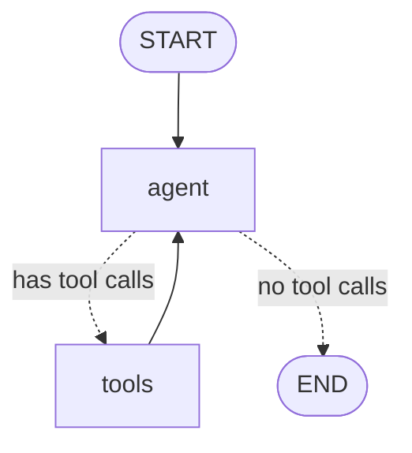

# Lesson 5: Tools and agents (an API Test Agent)

| | |
|---|---|
| **Time** | 60 minutes |
| **LLM needed** | Optional (runs offline without a key) |
| **Code** | [`l05_tools_api_agent.py`](l05_tools_api_agent.py) · API under test [`booking_api.py`](booking_api.py) |
| **You will learn** | `@tool`, `bind_tools`, `MessagesState`, `ToolNode`, `tools_condition`, the ReAct loop, `create_agent` |

## Workflow vs agent

| | Workflow (Lessons 1-4) | Agent (this lesson) |
|---|---|---|
| Who decides the next step? | **You**, with edges and routers | **The LLM**, by choosing tools |
| Good for | known processes: regression runs, report pipelines | open-ended work: exploratory API testing, debugging |
| Predictability | high | lower, so you need guardrails |

**Start with a workflow. Reach for an agent only when the steps genuinely can't be known in advance.**
Exploratory API testing is a good fit: which request to send next depends on the previous response.

## The API under test

[`booking_api.py`](booking_api.py) is a local mini clone of **restful-booker** (the well-known
API-testing practice app). It starts automatically on a free port. It has **4 planted bugs**, and
the agent's job is to find them by comparing real responses with the spec (`API_SPEC`).

Want to poke it yourself first? `python lessons/booking_api.py` starts it on http://127.0.0.1:3001.

## The graph



This is the **ReAct loop** (Reason + Act): the LLM reasons, picks a tool, sees the result, and repeats
until it answers without calling a tool.

## Run it

```bash
python lessons/l05_tools_api_agent.py              # hand-built graph
python lessons/l05_tools_api_agent.py --prebuilt   # same agent, one line: create_agent(...)
```

```text
[agent] -> read_api_spec({})
[tool]  <- Booking API - requirements ...
[agent] -> send_request({"method": "GET", "path": "/booking/abc"})
[tool]  <- {"status": 500, "body": "Internal Server Error"}
...
[agent] final answer:
## API test report
PASS  health check: GET /ping -> 201 (spec: 201)
FAIL  missing firstname: POST /booking -> 500 (spec: 400)
FAIL  negative totalprice: POST /booking -> 200 (spec: 400)
FAIL  checkout before checkin: POST /booking -> 200 (spec: 400)
FAIL  non-numeric id: GET /booking/abc -> 500 (spec: 404)
...
```

Offline, the "agent brain" is a scripted test plan, so you can study the mechanics. With a real key,
**Claude plans the tests itself**. It may fetch an auth token, try PUT, send two requests in
parallel, or find the bugs in a different order. The run is non-deterministic, and that's the
point of an agent.

## Concept 1: `@tool` (the docstring is the prompt)

```python
@tool
def send_request(method: Literal["GET", "POST", "PUT", "DELETE"], path: str,
                 body: dict | None = None, token: str | None = None) -> str:
    """Send an HTTP request to the Booking API. Returns the status code and response body.

    Args:
        path: Path only, e.g. /booking or /booking/1. The base URL is added for you.
        ...
    """
```

- The **docstring** becomes the tool description the LLM reads to decide *when* to use it.
- The **type hints** become the argument schema. `Literal[...]` turns into an enum, so the model
  can't invent a `PATCH`.

### Good tool design for QA agents

| Rule | In this lesson |
|---|---|
| Scope the tool | `make_tools(base_url)` means the agent can only reach **this** API, never an arbitrary URL |
| Return errors as text | `except requests.RequestException: return json.dumps({"error": ...})` |
| Keep outputs small | `response.text[:500]`, because every tool result is sent back to the LLM (tokens cost money) |
| Make it hard to misuse | enums for fixed choices, clear arg docs, path normalisation |

> **Gotcha:** by default `ToolNode` returns *invalid-argument* errors to the LLM, but an exception
> **raised inside your tool crashes the whole run**. Catch expected errors in the tool.

## Concept 2: the tool-call cycle

```text
HumanMessage   "Test POST /booking ..."
AIMessage      tool_calls=[{name: "send_request", args: {...}, id: "call_3"}]   <- agent node
ToolMessage    '{"status": 500, ...}'   tool_call_id="call_3"                    <- tools node
AIMessage      tool_calls=[...]                                                  <- agent again
...
AIMessage      "## API test report ..."  (no tool_calls, so tools_condition ends the run)
```

- `llm.bind_tools(tools)` sends the tool schemas with every request.
- `ToolNode(tools)` executes every tool call in the last `AIMessage`, in parallel when there are several.
- `tools_condition` is a prebuilt router: `"tools"` if there are tool calls, `END` otherwise.

## Concept 3: `MessagesState`

```python
class MessagesState(TypedDict):
    messages: Annotated[list[AnyMessage], add_messages]
```

The state *is* the conversation. The `add_messages` reducer appends new messages, and updates a
message in place if one with the same id already exists.

## Concept 4: the one-liner

```python
from langchain.agents import create_agent
agent = create_agent(llm, tools=make_tools(base_url), system_prompt=SYSTEM_PROMPT)
```

Same loop, prebuilt. Build it by hand once (like you just did) so you know what's inside. After
that, use the prebuilt one and customise it.

> Older tutorials use `from langgraph.prebuilt import create_react_agent`. In LangGraph v1 that's
> **deprecated** in favour of `langchain.agents.create_agent`.

## Guardrails every agent needs

1. **`recursion_limit`** on every run (`{"recursion_limit": 40}`). Each tool round costs 2 steps.
2. **Scoped tools**: least privilege, like a test user with minimal permissions.
3. **No destructive tools without approval.** Lesson 7 adds a human checkpoint.
4. **Assert on outcomes, not wording.** In tests, check *which bugs were found*, not the exact
   report text (Lesson 10).

## Exercises

1. **Auth tool.** Add a `get_auth_token()` tool that calls `POST /auth` and returns the token.
   Change the mission to also test `PUT` with and without the token.
2. **Bug recorder.** Add a `record_bug(title, request, expected_status, actual_status)` tool that
   appends to a Python list. After the run, print the list: structured findings instead of prose.
3. **Break it.** Remove the `try/except` in `send_request` and pass a wrong base URL
   (`http://127.0.0.1:1`). What happens? Put it back: what does the agent do now?
4. **Starve it.** Run with `{"recursion_limit": 6}`. How many requests does it manage?
5. **Real Claude** (with a key): run it three times. Does it find all 4 bugs every time? What does
   that tell you about using agents for regression testing vs exploratory testing?

## Interview questions

<details>
<summary>How does tool calling work under the hood?</summary>

The tool schemas (name, description, JSON schema of args) are sent with the request. The model
replies with a structured tool call instead of text. Your code executes the function and sends the
result back as a tool result message with the matching id, then calls the model again. The loop
ends when the model answers without calling a tool.
</details>

<details>
<summary>What is the ReAct pattern?</summary>

Reason + Act: the model alternates between reasoning about what to do, acting (calling a tool)
and observing the result, until it can answer. In LangGraph it's two nodes (`agent`, `tools`) and
a conditional edge (`tools_condition`) forming a cycle.
</details>

<details>
<summary>How do you stop an agent from looping forever or doing something dangerous?</summary>

Put a `recursion_limit` on every run, scope tools narrowly (least privilege), return errors as
data, require human approval (`interrupt`) before destructive actions, and monitor or trace every
run (e.g. with LangSmith).
</details>

---
Previous: [Lesson 4](l04_llm_testcase_generator.md) · Next: [Lesson 6: Memory and checkpoints](l06_memory_checkpoints.md)
