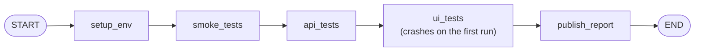

# Lesson 6: Memory and checkpoints (resume a crashed regression run)

| | |
|---|---|
| **Time** | 40 minutes |
| **LLM needed** | Optional (Part 2 runs offline without a key) |
| **Code** | [`l06_memory_checkpoints.py`](l06_memory_checkpoints.py) |
| **You will learn** | Checkpointers, `thread_id`, `get_state`, `get_state_history`, resume, time travel, chat memory |

## The QA problem

Your 2-hour regression run crashes at minute 90: the Selenium grid died. Every QA engineer
has lived this. Without checkpoints you rerun everything. **With a checkpointer, LangGraph saves the
state after every step**, so you fix the grid and resume exactly where it stopped.



## Run it

```bash
python lessons/l06_memory_checkpoints.py
```

```text
=== 1. Start the nightly run... and the grid goes down ===
CRASH in ui_tests: selenium-grid:4444 is not responding

=== 2. Inspect the saved state ===
next stage to run: ('ui_tests',)
results so far:    ['setup: ...', 'smoke: 12/12 passed', 'api: 48/48 passed']

=== 3. Fix the grid and RESUME (invoke with None + the same thread_id) ===
stage executions: {'setup_env': 1, 'smoke_tests': 1, 'api_tests': 1, 'ui_tests': 2, 'publish_report': 1}
                  <- smoke and api ran only ONCE

=== 5. Time travel: re-publish to another channel WITHOUT re-running tests ===
Regression report for build 2.4.1 -> #release-managers

=== Part 2: chat memory = checkpoints + thread_id ===
[thread sprint-42] You are testing build 3.0.0.
[thread sprint-43] I don't know yet - which build is it?
```

## Concept 1: one line turns persistence on

```python
graph = builder.compile(checkpointer=InMemorySaver())
config = {"configurable": {"thread_id": "nightly-2026-09-30"}}
graph.invoke({"build": "2.4.1", "channel": "#qa-nightly"}, config)
```

- A **checkpoint** is a snapshot of the state after a step.
- A **thread** (`thread_id`) is one run's timeline of checkpoints. Use one thread per test run,
  per bug, per chat conversation.
- `InMemorySaver` keeps everything in RAM, which is great for learning and tests. For real persistence
  across restarts, swap in `SqliteSaver` (`pip install langgraph-checkpoint-sqlite`) or
  `PostgresSaver`. **Your graph code doesn't change.**

## Concept 2: inspect and resume

```python
snapshot = graph.get_state(config)
snapshot.next          # ('ui_tests',)   <- where it stopped
snapshot.values        # the state at that point

graph.invoke(None, config)   # None = "no new input, continue this thread"
```

LangGraph re-runs **only the step that failed**. Completed steps come from the checkpoint.

## Concept 3: the audit trail

```python
for checkpoint in graph.get_state_history(config):   # newest first
    checkpoint.metadata["step"], checkpoint.next, checkpoint.values
```

Every step of every run is recorded. For AI workflows this is your **audit log**: which state
led the agent to that decision? That's invaluable when a stakeholder asks "why did the bot file
this bug?"

## Concept 4: time travel (fork a run)

```python
before_publish = next(c for c in graph.get_state_history(config) if c.next == ("publish_report",))
fork = graph.update_state(before_publish.config, {"channel": "#release-managers"})
graph.invoke(None, fork)     # only publish_report runs again
```

Pick an old checkpoint, change a value, and continue from there. The original run is untouched and
the fork is a new branch of history. QA uses:
- re-run only the last stage with different settings
- **debug an agent**: go back to the step before it made a bad decision, fix the state, and see what it does now

## Concept 5: chat "memory" is the same mechanism

```python
assistant.invoke({"messages": [HumanMessage("We are testing build 3.0.0 on staging today.")]}, sprint)
assistant.invoke({"messages": [HumanMessage("Which build am I testing?")]}, sprint)   # remembers
assistant.invoke({"messages": [HumanMessage("Which build am I testing?")]}, other)    # new thread: doesn't
```

Each `invoke` on the same thread **appends** to the saved `messages` (the `add_messages` reducer),
so the LLM sees the whole conversation. Different thread, different memory.

> This is **short-term (thread) memory**. For facts that should survive across threads (for example
> "our staging URL is ..."), LangGraph has a separate long-term `Store`. That's out of scope here.

## Exercises

1. **SQLite.** `pip install langgraph-checkpoint-sqlite`, then use
   `from langgraph.checkpoint.sqlite import SqliteSaver` with
   `SqliteSaver.from_conn_string("runs.db")` (it's a context manager). Crash the run, **stop the
   Python process**, start it again and resume. Real persistence.
2. **Two nightly runs.** Run the graph twice with different `thread_id`s. Show that
   `get_state_history` is separate for each.
3. **Replay.** `graph.invoke(None, before_publish.config)` without `update_state`. What runs?
4. **Debug an agent.** In Lesson 5's agent, add a checkpointer, run it, and print the history.
   Find the checkpoint where the agent received the `/booking/abc` response.

## Interview questions

<details>
<summary>What is a checkpointer, and what is a thread?</summary>

A checkpointer persists a snapshot of the graph state after every step (in memory, SQLite,
Postgres...). A thread (`thread_id`) groups the checkpoints of one run or conversation. Together
they give you resume after failure, human-in-the-loop pauses, memory, and time travel.
</details>

<details>
<summary>How do you resume a graph that failed halfway?</summary>

Compile it with a checkpointer and run it with a `thread_id`. After fixing the cause, call
`graph.invoke(None, same_config)`. LangGraph restarts from the failed step and doesn't re-run the
steps that already completed.
</details>

<details>
<summary>What is time travel in LangGraph?</summary>

Picking an earlier checkpoint from `get_state_history`, optionally modifying it with
`update_state`, and invoking from that checkpoint's config. It forks a new branch of the run.
It's useful for debugging agent decisions and re-running only part of a workflow.
</details>

---
Previous: [Lesson 5](l05_tools_api_agent.md) · Next: [Lesson 7: Human-in-the-loop](l07_human_in_the_loop.md)
