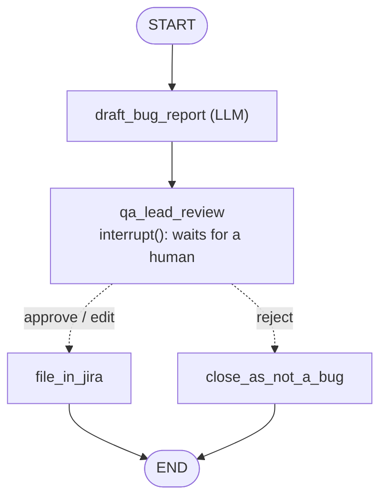

# Lesson 7: Human-in-the-loop (the QA Lead approves bug reports)

| | |
|---|---|
| **Time** | 40 minutes |
| **LLM needed** | Optional (runs offline without a key) |
| **Code** | [`l07_human_in_the_loop.py`](l07_human_in_the_loop.py) |
| **You will learn** | `interrupt()`, `Command(resume=...)`, why a checkpointer is required, approve/edit/reject flows |

## The QA problem

An agent that files bugs by itself will, sooner or later, flood Jira with duplicates and
"bugs" that are documented behaviour. The sweet spot: **the agent drafts, a human decides.**



## Run it

```bash
python lessons/l07_human_in_the_loop.py          # you are the QA lead: type approve / edit / reject
python lessons/l07_human_in_the_loop.py --auto   # scripted: approve, edit severity, reject
```

```text
--- PAUSED before qa_lead_review: the QA lead must decide ---
  title:    POST /booking returns 200 instead of 400 (negative totalprice)
  severity: minor
  QA lead says: {'action': 'edit', 'changes': {'severity': 'major'}}
==> filed QA-102 [major] POST /booking returns 200 instead of 400 (negative totalprice)

--- PAUSED before qa_lead_review: the QA lead must decide ---
  title:    DELETE /booking/1 returns 201 instead of 200 (delete a booking)
  QA lead says: {'action': 'reject', 'reason': 'documented quirk - the API spec says DELETE returns 201'}
==> closed, not a bug: documented quirk - the API spec says DELETE returns 201
```

The third "bug" shows why the human matters. A tester expected 200, but the spec documents 201
as a quirk. Without review, that noise lands in Jira.

## Concept 1: `interrupt()` pauses the graph

```python
def qa_lead_review(state):
    decision = interrupt({                 # <- the run stops HERE
        "question": "File this bug? approve / edit / reject",
        "draft": state["draft"],
    })
    return {"decision": decision}          # <- runs after the human answers
```

The value you pass to `interrupt()` goes to whoever is driving the graph: a CLI, a Slack bot,
a web UI. The caller sees it in the result:

```python
result = graph.invoke({"evidence": evidence}, config)
result["__interrupt__"][0].value      # {'question': ..., 'draft': {...}}
graph.get_state(config).next          # ('qa_lead_review',) = paused here
```

## Concept 2: `Command(resume=...)` continues the run

```python
result = graph.invoke(Command(resume={"action": "approve"}), config)   # same thread_id!
```

The value you resume with becomes the **return value of `interrupt()`** inside the node.

## Concept 3: a checkpointer is required

The paused run has to be **stored** while it waits. That could be 30 seconds, or a whole weekend
until the QA lead is back. So `compile(checkpointer=...)` is mandatory, and you resume with the
**same `thread_id`**. With `SqliteSaver` or `PostgresSaver` the approval can happen in a different
process (a web app) from the one that started the run.

## Gotcha 1: the paused node re-runs from the top

When you resume, LangGraph **re-executes the whole node** and `interrupt()` returns the resume
value this time. So any code *before* `interrupt()` runs twice:

```python
def qa_lead_review(state):
    send_slack_message("please review")   # BAD: sent again on resume
    decision = interrupt({...})
    create_jira_ticket(...)               # OK: runs once, after the answer
```

Keep code before `interrupt()` side-effect free, or put side effects in their own node.

## Gotcha 2: keep checkpointed state as plain data

The draft is stored as `BugReport.model_dump()` (a dict), not as a `BugReport` object. Checkpointers
serialize the state, and for security, recent LangGraph versions only restore custom classes that
you **explicitly allow-list**. Plain dicts, lists, strings and LangChain messages always work. Turn
the data back into a model where you need validation:

```python
report = BugReport.model_validate({**state["draft"], **changes})   # also validates the human's edits
```

## Approve / edit / reject: the standard HITL menu

| Human says | Graph does |
|---|---|
| `{"action": "approve"}` | file the draft as-is |
| `{"action": "edit", "changes": {"severity": "major"}}` | apply the edits, **re-validate**, then file |
| `{"action": "reject", "reason": "..."}` | close, and record why (useful data for improving the agent!) |

## Exercises

1. **Duplicate check.** Before the interrupt, add a `find_duplicates` node that searches `JIRA` for
   a ticket with the same title and passes the matches to the human in the interrupt payload.
2. **Timeout policy.** If the QA lead answers `skip`, route to a `snooze` node that sets
   `outcome="waiting for review"` and ends the run.
3. **Approve before running.** Put an `interrupt()` in Lesson 5's agent *before* any `DELETE`
   request is executed. Hint: wrap the tool or add a review node between `agent` and `tools`.
4. **Resume later.** Use `SqliteSaver`, start a run in one Python process, and resume it with
   `Command(resume=...)` from a second process.

## Interview questions

<details>
<summary>How do you add human approval to a LangGraph agent?</summary>

Call `interrupt(payload)` inside a node. The graph pauses, the checkpointer saves the state, and
the caller receives the payload under `__interrupt__`. Resume with
`graph.invoke(Command(resume=answer), config)` using the same `thread_id`. `interrupt()` then
returns `answer` inside the node.
</details>

<details>
<summary>Why does <code>interrupt()</code> need a checkpointer?</summary>

The run stops mid-graph and must continue later, maybe in another process. The state at the
pause point has to be persisted, and that's exactly what a checkpointer does.
</details>

<details>
<summary>What happens to the code before <code>interrupt()</code> when you resume?</summary>

It runs again: the node restarts from the beginning, and this time `interrupt()` returns the
resume value instead of pausing. So code before it must be idempotent or free of side effects.
</details>

---
Previous: [Lesson 6](l06_memory_checkpoints.md) · Next: [Lesson 8: Parallel test execution](l08_parallel_send.md)
