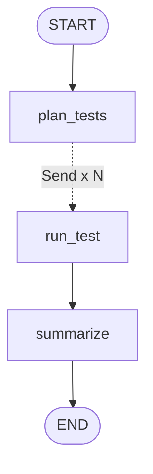

# Lesson 8: Parallel test execution (map-reduce with `Send`)

| | |
|---|---|
| **Time** | 30 minutes |
| **LLM needed** | No |
| **Code** | [`l08_parallel_send.py`](l08_parallel_send.py) |
| **You will learn** | `Send`, dynamic fan-out, worker inputs, reducers for fan-in, `max_concurrency`, static parallel branches |

## The QA problem

You wouldn't run 1,000 API tests one by one. You'd use `pytest -n 8`. In an AI QA workflow the
same need shows up: run every generated test case, check every endpoint, triage every failure.
And you often **don't know how many items there are until runtime**, because an LLM planned them.

## The graph



One `run_test` box in the diagram, but at runtime LangGraph starts **N copies in parallel**, one per
test case.

## Run it

```bash
python lessons/l08_parallel_send.py
```

```text
smoke, parallel                                4 tests in 0.33s
regression, sequential (max_concurrency=1)    12 tests in 3.66s
regression, 4 workers  (max_concurrency=4)    12 tests in 0.95s
regression, parallel                          12 tests in 0.64s

Regression summary:
8/12 passed
  FAIL TC05 get non-numeric id: expected 404, got 500
  FAIL TC07 create without firstname: expected 400, got 500
  FAIL TC08 create with negative price: expected 400, got 200
  FAIL TC09 create with checkout before checkin: expected 400, got 200
```

Same graph, same tests: **3.66s sequential vs 0.64s parallel.** (Your timings will differ a bit.)

## Concept 1: `Send` for a dynamic fan-out (map)

```python
def fan_out(state) -> list[Send]:
    return [Send("run_test", {"base_url": ..., "token": ..., "case": case})
            for case in state["selected"]]

builder.add_conditional_edges("plan_tests", fan_out, ["run_test"])
```

A router normally returns *one label*. Here it returns a **list of `Send` objects**, and each one
starts `run_test` with its **own input**. Two tags give two different fan-outs: `smoke` sends 4,
`regression` sends 12.

## Concept 2: the worker's input is private

```python
class WorkerInput(TypedDict):      # NOT the whole SuiteState
    base_url: str
    token: str
    case: dict

def run_test(job: WorkerInput) -> dict: ...
```

Each worker sees only the one test case it was sent, like a pytest-xdist worker that only
knows its own test. That keeps workers independent and easy to unit-test.

## Concept 3: a reducer collects the results (reduce)

```python
results: Annotated[list[dict], operator.add]
```

Twelve workers each return `{"results": [one_result]}` in the same step. Without a reducer they'd
**conflict** (LangGraph raises `InvalidUpdateError` when parallel nodes write the same plain
key). With `operator.add` they are concatenated. Then `summarize` runs **once**, after all
workers finish (the fan-in).

## Concept 4: `max_concurrency` (your `-n` flag)

```python
graph.invoke(inputs, {"max_concurrency": 4})
```

Cap the parallelism to protect the system under test, respect rate limits (including LLM API
rate limits when every worker calls Claude), or stay within a Selenium grid's session limit.

## Concept 5: static parallel branches

When the branches are **known in advance**, you don't need `Send`, just several edges:

```python
builder.add_edge(START, "api_tests")
builder.add_edge(START, "ui_tests")
builder.add_edge(START, "security_scan")
builder.add_edge(["api_tests", "ui_tests", "security_scan"], "report")   # waits for all three
```

| | Static branches | `Send` |
|---|---|---|
| Number of branches | fixed in code | decided at runtime |
| Each branch gets | the shared state | its own payload |
| Example | api + ui + security suites | one worker per generated test case |

## QA gotcha: parallel tests must be independent

`TC12` deletes booking 3. Run the suite twice against the same API and TC12 fails the second
time: the data is already gone. That's why `main` starts a **fresh API per run**. Your real
parallel suites need the same discipline: unique test data per test, no ordering assumptions.

## Exercises

1. **Tag filter.** Add an `"auth"` tag to TC10-TC12 and run only those.
2. **Timing per test.** Record each worker's duration in its result and print the slowest 3.
3. **Retry inside the worker.** Start the API with `start_booking_api(flaky_503=3)` and add a
   `RetryPolicy` (Lesson 3) to `run_test` that retries on a custom `ServerBusy` exception you raise
   for 503 responses. Do all 12 tests still pass the same way?
4. **Generated tests.** Replace `TEST_CASES` with cases produced by an LLM (hint: Lesson 9 does this).

## Interview questions

<details>
<summary>What is the <code>Send</code> API used for?</summary>

Dynamic fan-out (map-reduce): a conditional edge returns a list of `Send(node, payload)`, and
LangGraph runs that node once per payload, in parallel, in the same step. You use it when the number
of parallel tasks is only known at runtime.
</details>

<details>
<summary>How do parallel nodes write to the same state key safely?</summary>

Give the key a reducer, such as `Annotated[list, operator.add]`. LangGraph applies all updates from
the step through the reducer. Without one, concurrent writes to the same key raise an error.
</details>

<details>
<summary>How do you limit parallelism in LangGraph?</summary>

With `max_concurrency` in the run config: `graph.invoke(inputs, {"max_concurrency": 4})`.
</details>

---
Previous: [Lesson 7](l07_human_in_the_loop.md) · Next: [Lesson 9: Multi-agent QA team](l09_multi_agent_qa_team.md)
