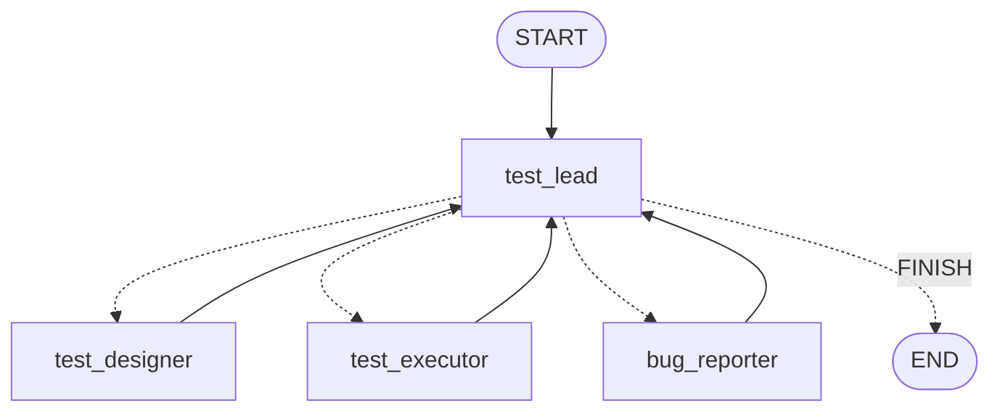

# Lesson 9: Multi-agent (a QA team led by a Test Lead)

| | |
|---|---|
| **Time** | 45 minutes |
| **LLM needed** | Optional (runs offline without a key) |
| **Code** | [`l09_multi_agent_qa_team.py`](l09_multi_agent_qa_team.py) |
| **You will learn** | The supervisor pattern, `Command(goto=..., update=...)`, subgraphs, constrained routing decisions |

## Why a team instead of one super-agent?

Put "design tests, run them, triage, write bugs, decide when done" into one prompt with every
tool, and the agent gets confused: it skips steps, mixes roles, and its context fills up. Real QA
teams split the work, and so can agents:

| Agent | Job | Tools / type |
|---|---|---|
| **test_lead** (supervisor) | decides who works next, and when the team is done | LLM, structured decision |
| **test_designer** | designs API test cases from the spec | LLM, structured output |
| **test_executor** | runs the tests in parallel | **no LLM**, a subgraph (Lesson 8's pattern) |
| **bug_reporter** | writes bug reports for failures | LLM, structured output |

Notice the executor has **no LLM**. Deterministic work should stay deterministic, even inside a
"multi-agent" system.

## The graph



A hub and spokes. Every specialist reports back to the lead, and the lead picks the next step.

## Run it

```bash
python lessons/l09_multi_agent_qa_team.py
```

```text
Team log:
  test_lead     -> test_designer: no test cases yet
  test_designer: designed 7 tests
  test_lead     -> test_executor: 7 tests are ready to run
  test_executor: ran 7 tests in parallel, 2 failed
  test_lead     -> bug_reporter: 2 failures need bug reports
  bug_reporter : wrote 2 bug reports
  test_lead     -> FINISH: tests ran and every failure has a bug report

Bug reports:
  - GET /booking/abc (get non-numeric id) returns 500, expected 404
  - POST /booking (create without lastname) returns 500, expected 400
```

With a real key, Claude designs its own test cases from the spec, so it may find more (or
different) bugs on each run.

## Concept 1: `Command` means "update the state AND go there"

```python
def test_lead(state) -> Command[Literal["test_designer", "test_executor", "bug_reporter", "__end__"]]:
    decision = decide.invoke([SystemMessage(LEAD_PROMPT), HumanMessage(status_report(state))])
    return Command(
        goto=END if decision.next == "FINISH" else decision.next,
        update={"log": [f"test_lead -> {decision.next}: {decision.reason}"]},
    )
```

- Until now routing lived in `add_conditional_edges`. With `Command`, **a node routes itself**.
- The return-type annotation lists the possible destinations. LangGraph uses it to validate the
  graph and to draw the dotted edges in the diagram.
- `update` is applied exactly like a normal node return value.

| Use a conditional edge when... | Use `Command` when... |
|---|---|
| routing is a pure function of the state | the node computes something AND decides where to go (like an LLM decision) |
| you want the router unit-testable on its own | you want a hand-off in one step |

## Concept 2: constrain the LLM's decision

```python
class LeadDecision(BaseModel):
    next: Literal["test_designer", "test_executor", "bug_reporter", "FINISH"]
    reason: str
```

The lead **cannot** route to a node that doesn't exist, because structured output enforces the
enum. The `reason` field makes every decision explainable in the log.

## Concept 3: subgraphs

```python
executor = build_executor()       # a compiled graph: Send fan-out + reducer (Lesson 8)

def test_executor(state):
    out = executor.invoke({"base_url": state["base_url"], "tests": state["tests"]})
    return {"results": out["results"], "log": [...]}
```

A compiled graph is just a runnable, so you can call it from a node. You get modular pieces you
can build and test separately and reuse across projects.

There are two ways to plug in a subgraph:

| How | When |
|---|---|
| `builder.add_node("executor", executor)`: add the compiled graph **directly** as a node | parent and subgraph **share state keys** |
| call it **inside a node function** (what we did) | schemas differ: you map input and output explicitly |

> **Gotcha with the direct form:** if the parent and the subgraph both have a key with an `operator.add`
> reducer (like `log`), the subgraph receives the parent's list, appends to it, and returns the whole
> list, which the parent then **appends again**, duplicating entries. Mapping explicitly avoids that.

## Concept 4: a structured output gotcha (free-form dicts)

```python
body_json: str = Field(description='The JSON request body as a string, or "" for no body')
```

Why not `body: dict`? Native structured output only allows objects whose fields are declared.
A free-form `dict` becomes "an object with **no** allowed properties", so the model can only ever
return `{}`. Every POST test would silently send an empty body. **Always check the schema you send**
(Lesson 10 shows how to test it). A JSON string field is the simple fix.

## Guardrails for multi-agent systems

1. **Step budget:** `{"recursion_limit": 25}` for the whole team, because a confused lead can ping-pong forever.
2. **Enumerated routing:** the lead picks from a `Literal`.
3. **Observable hand-offs:** the `log` records every decision and its reason.
4. **Right tool for the job:** only three of the four agents use an LLM.

## Exercises

1. **Add a specialist.** Create a `security_tester` agent that designs auth tests (PUT/DELETE
   without a token, a wrong token). Add it to the lead's `Literal` and prompt.
2. **Different models.** Give the bug reporter its own, cheaper model, for example
   `ChatAnthropic(model="claude-haiku-4-5", max_tokens=16000)`, while the lead keeps the default.
   Which roles need the strongest model, and which don't?
3. **Direct subgraph.** Change `test_executor` to `builder.add_node("test_executor", executor)`
   (the direct form). What do you need to change so the log isn't duplicated?
4. **Human lead.** Replace the LLM lead with `interrupt()` (Lesson 7): *you* choose the next agent each round.

## Interview questions

<details>
<summary>What is the supervisor pattern?</summary>

A multi-agent architecture where one agent (the supervisor) receives the task, delegates each
step to a specialist agent, gets control back after every step, and decides when the work is
finished. In LangGraph it's a hub node routing with `Command(goto=...)` or conditional edges, with
edges from every worker back to the hub.
</details>

<details>
<summary>What does <code>Command</code> do in LangGraph?</summary>

It lets a node return a state update and a routing decision together:
`Command(update={...}, goto="next_node")`. It's used for agent hand-offs and dynamic routing without
a separate conditional edge. The return-type annotation declares the possible destinations.
</details>

<details>
<summary>What's a subgraph and why use one?</summary>

A compiled graph used as part of another graph, either added directly as a node (shared state
keys) or invoked inside a node (explicit mapping). It enables modular, reusable, separately
testable components, for example an executor team that several workflows can share.
</details>

---
Previous: [Lesson 8](l08_parallel_send.md) · Next: [Lesson 10: Testing and evaluating your agents](l10_testing_your_agents.md)
