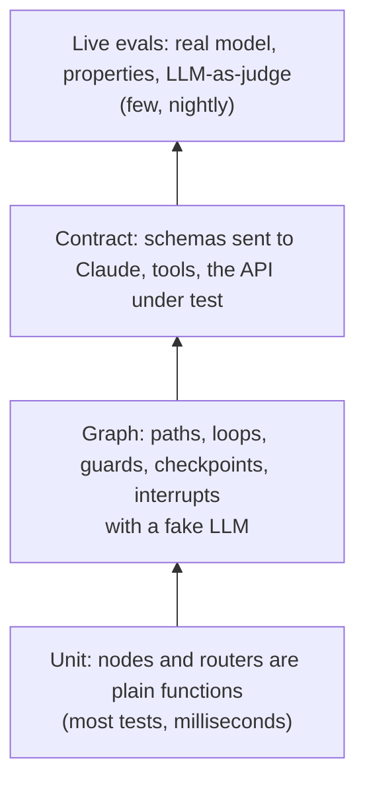

# Lesson 10: Testing and evaluating your agents (QA for AI)

| | |
|---|---|
| **Time** | 60 minutes |
| **LLM needed** | No for `pytest`; yes for `pytest -m live` |
| **Code** | [`../tests/`](../tests), all tests for this course |
| **You will learn** | How to test LangGraph apps: fake LLMs, path and structure tests, guards, checkpoints, HITL, contracts, live evals |

This is where your QA experience becomes a superpower. Most people building agents **don't know
how to test them**. You will.

## Run the suite

```bash
pytest                         # 66 tests, offline, no API key, about 40 seconds
pytest -m live                 # the real-model tests (needs ANTHROPIC_API_KEY, costs money)
pytest tests/test_l01_to_l03_basics.py -k router -v    # the usual pytest tricks all work
```

```text
..........xxxx........................................................   [100%]
66 passed, 2 deselected, 4 xfailed in 41.18s
```

## Why agents are hard to test, and the strategy

| Problem | Strategy |
|---|---|
| LLM output is **non-deterministic** | keep LLM calls in a few nodes; test everything else deterministically |
| LLM calls are **slow and cost money** | inject a **fake LLM** in unit and graph tests |
| Wording changes every run | assert **outcomes and properties**, never exact text |
| Agents can loop or misbehave | test the **guards** (recursion limits, max drafts, validation) |
| Quality is subjective | **evals**: property checks plus LLM-as-judge, run on a schedule |

## The agent testing pyramid



## 13 techniques, all in `tests/`

### Level 1: unit tests (no graph needed)

**1. Call nodes directly.** A node is a function `state -> dict`:

```python
def test_pass_rate_ignores_skipped_tests():
    results = [{"status": "passed"}, {"status": "failed"}, {"status": "skipped"}]
    assert l01.compute_stats({"results": results})["stats"]["pass_rate"] == 50.0
```

**2. Parametrize the router, one row per route.** Your routing table *is* the test table:

```python
@pytest.mark.parametrize("failure, expected", [
    (l02.FAILURES[1], "flaky_test"),
    (l02.FAILURES[2], "environment"), ...
])
def test_every_failure_is_routed_to_the_right_category(failure, expected):
    assert l02.classify_failure(failure)["category"] == expected
```

### Level 2: graph tests with a fake LLM

**3. Path tests: which nodes ran, in which order?**

```python
steps = graph.stream(l02.FAILURES[1], stream_mode="updates")
assert [node for step in steps for node in step] == ["classify_failure", "quarantine_test", "notify_team"]
```

**4. Structure tests** catch accidental rewiring:

```python
edges = {(e.source, e.target) for e in l01.build_graph().get_graph().edges}
assert edges == {("__start__", "parse_junit"), ...}
```

**5. Inject a fake LLM.** That's why every lesson has `build_graph(llm=None)`:

```python
fake = OfflineLLM(respond=l04.offline_test_designer)
final = l04.build_graph(llm=fake).invoke({"user_story": l04.USER_STORY})
assert final["drafts"] == 2 and final["review_issues"] == []
```

**6. Assert on the prompt.** The fake records what it was *asked*:

```python
second_prompt = fake.calls[1][-1].text
assert "AC3 is not covered" in second_prompt      # the reviewer feedback reached the LLM
```

**7. Test the guards with a misbehaving fake:**

```python
stubborn = OfflineLLM(respond=lambda messages: l04.FIRST_DRAFT)    # never improves
final = l04.build_graph(llm=stubborn).invoke(...)
assert final["drafts"] == l04.MAX_DRAFTS                          # the loop stopped

with pytest.raises(GraphRecursionError):                          # a lead that ping-pongs forever
    l09.build_graph(llm=OfflineLLM(respond=always_design)).invoke(..., {"recursion_limit": 25})
```

**8. Assert outcomes, not wording.** Extract the facts and compare sets:

```python
PLANTED = {"missing firstname", "negative totalprice", "checkout before checkin", "non-numeric id"}
assert failed_checks(final["messages"][-1].text) == PLANTED
```

**9. Checkpoint tests: crash, inspect, resume, fork:**

```python
with pytest.raises(ConnectionError):
    graph.invoke(inputs, config)
assert graph.get_state(config).next == ("ui_tests",)
final = graph.invoke(None, config)
assert executions["smoke_tests"] == 1          # not re-run
```

**10. Human-in-the-loop tests: the pause, every decision, and bad human input:**

```python
assert graph.get_state(config).next == ("qa_lead_review",)
assert l07.JIRA == []                          # nothing filed before the human decides

@pytest.mark.parametrize("decision, outcome_start, tickets", [approve, edit, reject])
...
with pytest.raises(ValidationError):           # "blocker" is not a valid severity
    graph.invoke(Command(resume={"action": "edit", "changes": {"severity": "blocker"}}), config)
```

### Level 3: contract tests

**11. Inspect the exact schema Claude would receive, without calling it:**

```python
claude = ChatAnthropic(model="claude-opus-5-5", api_key="sk-not-used")
schema = claude.with_structured_output(l04.TestSuite, method="json_schema") \
               .first.kwargs["output_config"]["format"]["schema"]
assert schema["$defs"]["TestCase"]["properties"]["type"]["enum"] == ["positive", "negative", "edge", "security"]
```

This style of test would have caught Lesson 9's silent bug, where a free-form `dict` field
can only ever be `{}`.

**12. Known bugs as strict xfail:**

```python
@pytest.mark.xfail(strict=True, reason="planted bug: negative price accepted")
def test_negative_price_returns_400(booking_api): ...
```

The suite stays green while the bug is open. The day someone fixes it, the xfail
**unexpectedly passes** and `strict=True` fails the run, so you remember to turn it into a normal test.

**13. Smoke-run every script.** `test_lesson_script_runs` executes every lesson file. Examples
and docs that don't run are bugs too.

### Level 4: live evals (the real model)

```python
pytestmark = [pytest.mark.live,
              pytest.mark.skipif(not os.getenv("ANTHROPIC_API_KEY"), reason="needs ANTHROPIC_API_KEY")]

def test_claude_suite_passes_the_quality_gate():
    final = l04.build_graph().invoke({"user_story": l04.USER_STORY})
    assert final["review_issues"] == []          # a PROPERTY, not exact text
```

**LLM-as-judge** handles qualities code can't check:

```python
class Judgement(BaseModel):
    score: int = Field(description="1 (unusable) to 5 (a new tester could run it without questions)")
    problems: list[str]

verdict = judge.invoke([SystemMessage(JUDGE_PROMPT), HumanMessage(suite_json)])
assert verdict.score >= 4, verdict.problems
```

Rules for live evals:
- They're **excluded by default** (`addopts = -m "not live"` in `pytest.ini`). Run them nightly,
  or before you change a prompt or model, not on every commit.
- A judge is an LLM too: give it a **specific rubric**, structured output, and check it
  against human judgement on a few samples before trusting it.
- Each run **costs money**: keep eval datasets small and focused.
- When a run fails, look at the trace. LangSmith (LangChain's tracing and eval platform) can
  record every step. Set `LANGSMITH_TRACING=true` and `LANGSMITH_API_KEY` to try it.

## What to run where

| When | What | Command |
|---|---|---|
| every save / commit (CI) | unit, graph and contract tests with fake LLMs | `pytest` |
| nightly / before a prompt change | live evals with the real model | `pytest -m live` |
| release | live evals plus a manual review of a sample of agent runs | your process |

## Exercises

1. **Your router, your test.** Add a test row for the `performance` category you created in
   Lesson 2's exercise.
2. **Safety assertion.** Write a test proving Lesson 5's agent never sends a `DELETE` *with* a
   token. Hint: inspect `final["messages"]` for `AIMessage.tool_calls`.
3. **Live agent eval.** Add a `live` test: the real Claude agent from Lesson 5 must find **at
   least 3 of the 4** planted bugs. Run it 3 times. Is it stable?
4. **Eval dataset.** Put 3 different user stories in a list and parametrize the live test over
   them. Report the pass rate.
5. **Snapshot the graph.** Save `graph.get_graph().draw_mermaid()` for the capstone to a file and
   write a test that fails when the structure changes.

## Interview questions

<details>
<summary>How do you test an application built on an LLM agent?</summary>

Separate the deterministic parts from the model. Unit-test nodes and routers as plain functions.
Test the graph (paths, loops, guards, checkpoints, human-in-the-loop) with an injected fake LLM.
Add contract tests for the schemas and tools you send to the model. Then run a small set of
live evals with the real model on a schedule, asserting properties and using an LLM-as-judge
for subjective qualities.
</details>

<details>
<summary>How do you make agent tests deterministic?</summary>

Dependency-inject the model and replace it with a scripted fake that returns fixed messages, tool
calls or structured objects. Pin the external systems (a local API with fixed seed data), and assert
on outcomes and structure rather than generated wording.
</details>

<details>
<summary>What is LLM-as-a-judge and what are its risks?</summary>

Using a model to grade another model's output against a rubric. It's useful for subjective
qualities like clarity, tone or completeness. Risks: the judge is non-deterministic, can be biased
(toward longer answers, or its own style), and costs money. Mitigate with specific rubrics, structured
scores, spot-checks against human ratings, and deterministic checks for everything objective.
</details>

---
Previous: [Lesson 9](l09_multi_agent_qa_team.md) · Next: [Capstone: an Autonomous API QA Agent](capstone_api_qa_agent.md)
